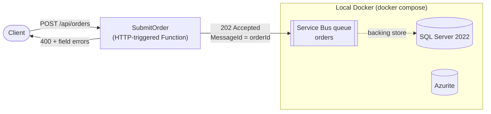

# Order Pipeline

An event-driven order intake pipeline built with **C# / .NET 10**, **Azure Functions (isolated worker)**, and **Azure Service Bus**. Everything runs locally in Docker (SQL Server, the Service Bus emulator, Azurite), so no Azure subscription is needed.

> **Status:** Step 1 of 5 is complete: HTTP intake, validation, and publishing to a Service Bus queue. See the [roadmap](#roadmap) for what's next.

## Architecture



**Request flow**

1. A client POSTs an order to `/api/orders`.
2. `SubmitOrder` deserializes the request and validates it with `OrderValidator`. Invalid requests get a `400` with an RFC 7807 `ValidationProblemDetails` body listing every failing field, and **nothing is published**.
3. A valid order is mapped to an `OrderSubmitted` message (with the order total computed) and sent to the `orders` queue.
4. The function returns `202 Accepted`, meaning the order is queued for processing, not yet processed.

**Design decisions**

- **The client supplies `orderId`, and it becomes the Service Bus `MessageId`.** If a client retries the same order after a timeout, the retry carries the same ID. That gives the downstream consumer a natural idempotency key, so a retry can't turn into a duplicate order.
- **Validation is a pure static class** with no Azure or HTTP dependencies, so it can be unit-tested in isolation.
- **Nullable request model.** `OrderRequest` fields are nullable so a missing field produces a clear validation error instead of an opaque deserialization failure.
- **`ServiceBusClient` / `ServiceBusSender` are DI singletons** (via `Microsoft.Extensions.Azure`), so the app reuses one AMQP connection instead of opening one per request.

## Tech stack

| Concern | Choice |
|---|---|
| Runtime | .NET 10, Azure Functions v4 (isolated worker, ASP.NET Core integration) |
| Messaging | Azure Service Bus (`Azure.Messaging.ServiceBus`); local: Service Bus emulator |
| Database | SQL Server 2022 (currently the emulator's backing store) |
| Storage | Azurite (for the Functions host's `AzureWebJobsStorage`) |
| Local infra | Docker Compose |

## Project structure

```
order-pipeline/
├── docker-compose.yml              # SQL Server, Service Bus emulator, Azurite
├── .env.example                    # copy to .env (SA password, EULA acceptance)
├── infra/servicebus/Config.json    # emulator entities: the "orders" queue
├── requests/orders.http            # sample requests (VS Code REST Client / Visual Studio)
├── src/OrderPipeline.Functions/
│   ├── Program.cs                  # host setup, Service Bus DI registration
│   ├── Orders/
│   │   ├── SubmitOrder.cs          # HTTP trigger: validate -> publish
│   │   ├── OrderValidator.cs       # validation rules
│   │   └── OrderModels.cs          # request DTOs and the OrderSubmitted message
│   └── local.settings.example.json # copy to local.settings.json
└── tests/smoke/
    ├── Run-SmokeTests.ps1          # end-to-end tests against the local stack
    └── peek-queue.cs               # finds a queued message by ID without consuming it
```

## Getting started

### Prerequisites

- [.NET 10 SDK](https://dotnet.microsoft.com/download)
- [Azure Functions Core Tools v4](https://learn.microsoft.com/azure/azure-functions/functions-run-local) (`func`)
- [Docker Desktop](https://www.docker.com/products/docker-desktop/) (on Windows, with the WSL 2 engine)

### 1. Configure

```powershell
Copy-Item .env.example .env
Copy-Item src/OrderPipeline.Functions/local.settings.example.json src/OrderPipeline.Functions/local.settings.json
```

Edit `.env` and set `MSSQL_SA_PASSWORD` to a strong password (at least 8 characters, mixing upper/lower case, digits and symbols). `ACCEPT_EULA=Y` accepts the SQL Server and Service Bus emulator license terms.

`local.settings.json` already points at the emulator; its connection string uses the emulator's fixed development key, not a secret.

### 2. Start the infrastructure

```powershell
docker compose up -d
```

The emulator waits for SQL Server to be healthy, then creates the `orders` queue. It's ready when this returns `healthy`:

```powershell
Invoke-RestMethod http://localhost:5300/health
```

### 3. Run the Functions app

```powershell
cd src/OrderPipeline.Functions
dotnet run
```

```
Functions:

        SubmitOrder: [POST] http://localhost:7071/api/orders
```

## API

### `POST /api/orders`

**Request**

```json
{
  "orderId": "3f2b9c1e-6a4d-4e8b-9f21-7c5d0a1b2c3d",
  "customerId": "cust-42",
  "items": [
    { "sku": "WIDGET-1", "quantity": 2, "unitPrice": 9.99 },
    { "sku": "GADGET-7", "quantity": 1, "unitPrice": 24.50 }
  ]
}
```

**Validation rules**

| Field | Rule |
|---|---|
| `orderId` | Required, non-empty GUID |
| `customerId` | Required, at most 64 characters |
| `items` | 1 to 100 items |
| `items[i].sku` | Required, at most 50 characters |
| `items[i].quantity` | 1 to 1,000 |
| `items[i].unitPrice` | Greater than 0, at most 1,000,000 |

**`202 Accepted`**

```json
{ "orderId": "3f2b9c1e-6a4d-4e8b-9f21-7c5d0a1b2c3d", "status": "Accepted" }
```

**`400 Bad Request`** (every failing field is reported at once)

```json
{
  "title": "One or more validation errors occurred.",
  "status": 400,
  "errors": {
    "orderId": ["orderId is required and must be a non-empty GUID."],
    "customerId": ["customerId is required."],
    "items[0].sku": ["sku is required."],
    "items[0].quantity": ["quantity must be between 1 and 1000."],
    "items[0].unitPrice": ["unitPrice must be greater than 0 and at most 1000000."]
  }
}
```

**Message published to the `orders` queue**

| Property | Value |
|---|---|
| `MessageId` | the `orderId` |
| `Subject` | `OrderSubmitted` |
| `ContentType` | `application/json` |

```json
{
  "orderId": "3f2b9c1e-6a4d-4e8b-9f21-7c5d0a1b2c3d",
  "customerId": "cust-42",
  "items": [
    { "sku": "WIDGET-1", "quantity": 2, "unitPrice": 9.99 },
    { "sku": "GADGET-7", "quantity": 1, "unitPrice": 24.50 }
  ],
  "total": 44.48,
  "submittedAtUtc": "2026-10-11T17:53:07.4494289+00:00"
}
```

To send requests by hand, open [`requests/orders.http`](requests/orders.http) in VS Code (with the REST Client extension) or Visual Studio and click **Send Request**.

## Testing

### End-to-end smoke tests

From the repo root:

```powershell
.\tests\smoke\Run-SmokeTests.ps1
```

If script execution is blocked: `powershell -ExecutionPolicy Bypass -File .\tests\smoke\Run-SmokeTests.ps1`

The script:

1. Runs `docker compose up -d` and waits for the Service Bus emulator to report healthy.
2. Reuses a Functions host already listening on `http://localhost:7071`, or starts one with `dotnet run` and stops it when done. Use `-BaseUrl http://localhost:7072` to run on another port.
3. Sends test orders and checks **both** the HTTP response **and** the queue: valid orders must appear with the right `MessageId` and body, and rejected orders must not appear at all.
4. Exits `0` if everything passes and `1` otherwise. If the host fails to start, its log is in `tests/smoke/functions-host.log`.

Docker Desktop must be running. Containers are left running afterwards; stop them with `docker compose down`.

**Sample output**

```
== Starting Docker containers ==
  Service Bus emulator is healthy

== Starting Functions host ==
  Functions host is up
  Warming up queue peek tool (first run compiles it)...

== Valid order is accepted and published ==
  PASS  returns 202 Accepted
  PASS  response echoes orderId
  PASS  message is on the 'orders' queue with MessageId = orderId
  PASS  Subject is OrderSubmitted
  PASS  ContentType is application/json
  PASS  total is computed (2 x 9.99 + 1 x 24.50 = 44.48)
  PASS  both line items carried over

== Missing required fields are rejected ==
  PASS  returns 400 Bad Request
  PASS  reports orderId error
  PASS  reports customerId error
  PASS  reports items error

== Bad line items are rejected and NOT published ==
  PASS  returns 400 Bad Request
  PASS  reports items[0].sku
  PASS  reports items[0].quantity
  PASS  reports items[0].unitPrice
  PASS  nothing published for the rejected order

== Field length limits are enforced ==
  PASS  returns 400 Bad Request
  PASS  customerId over 64 chars rejected
  PASS  sku over 50 chars rejected

== Malformed input is rejected ==
  PASS  truncated JSON returns 400
  PASS  empty body returns 400
  PASS  non-GUID orderId returns 400

(stopped the Functions host this script started; containers left running)

ALL PASSED: 22 passed, 0 failed
```

### Inspecting the queue

`peek-queue.cs` is a single-file .NET app that looks up a message by ID without removing it from the queue:

```powershell
dotnet run tests/smoke/peek-queue.cs -- 3f2b9c1e-6a4d-4e8b-9f21-7c5d0a1b2c3d
```

## Roadmap

- [x] **1. Intake:** HTTP-triggered Function validates orders and publishes to a Service Bus queue
- [ ] **2. Persistence:** Service Bus-triggered Function writes orders to SQL Server, with a unique key on message ID so redeliveries are idempotent
- [ ] **3. Failure handling:** a max delivery count routes poison messages to the dead-letter queue, and a replay Function reprocesses them
- [ ] **4. Fan-out:** switch from a queue to a topic with two subscriptions
- [ ] **5. Polish:** unit tests, GitHub Actions deployment

## Troubleshooting

| Symptom | Fix |
|---|---|
| `failed to connect to the docker API at npipe:////./pipe/docker_engine` | Docker Desktop isn't running. Start it and wait for "Engine running". |
| `docker compose up` reports `sqlserver` unhealthy and `servicebus` never starts | Usually `MSSQL_SA_PASSWORD` doesn't meet SQL Server's complexity rules. Check `docker compose logs sqlserver`. |
| Functions host can't connect to Service Bus | Make sure `http://localhost:5300/health` returns healthy and that `local.settings.json` exists. |
| Port 7071 already in use | Another Functions host is running. Stop it, or run the smoke tests with `-BaseUrl http://localhost:7072`. |
